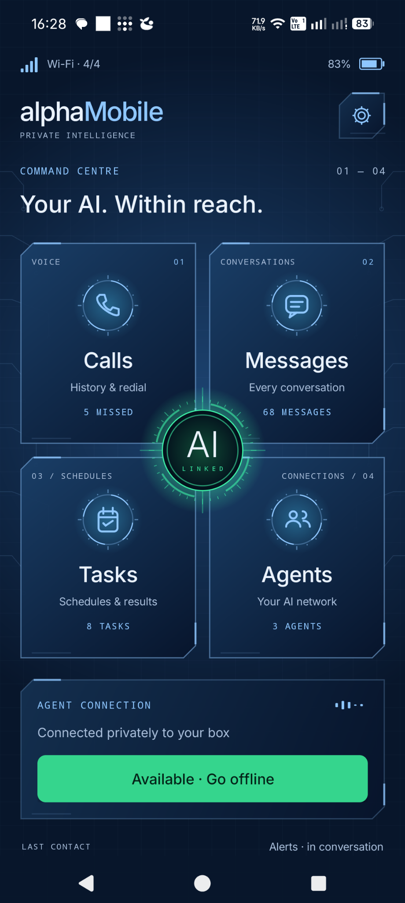
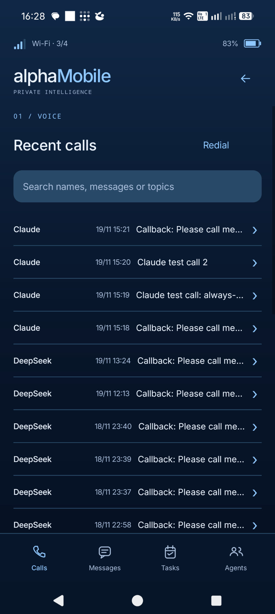
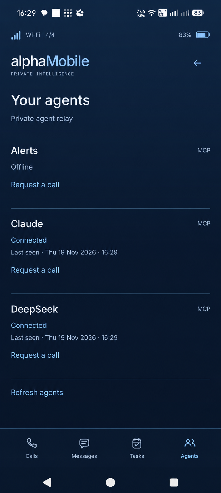
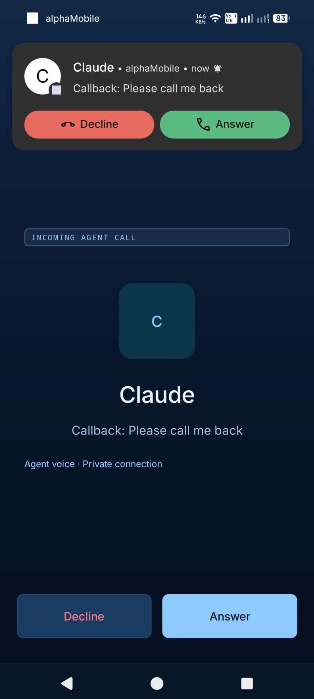

# alphaMobile

**A private Android phone interface for your AI agents — calls, messages and scheduled-task results over MCP, without a telephone provider.**

**No alphaMobile sign-up. No membership or subscription. No separate AI or telephone API account or key required.**

Connect the agents you already run to your own relay. alphaMobile is free, open-source software with no registration service, paid tiers or membership checks.

[Install](docs/INSTALL.md) · [Agent setup](docs/MCP.md) · [Always-on agent](adapters/agent-bridge/README.md) · [Build Android](docs/BUILD.md) · [Architecture](docs/ARCHITECTURE.md) · [Updates and backup](docs/OPERATIONS.md) · [Security](SECURITY.md)

Version **0.2.0** is the first generic public package, built from the tested 0.1.8 interface. Release **0.3.0** adds the optional [always-on agent bridge](adapters/agent-bridge/README.md); the app, relay and stdio bridge are unchanged. The project is MIT licensed. Each user runs their own relay and connects their own agents; no shared hosted service, provider API key or model is included.

<table align="center" width="100%">
  <tr>
    <th align="center" width="25%">Home</th>
    <th align="center" width="25%">Calls</th>
    <th align="center" width="25%">Agents</th>
    <th align="center" width="25%">Incoming call</th>
  </tr>
  <tr>
    <td align="center" width="25%"><a href="docs/screenshots/home.png"></a></td>
    <td align="center" width="25%"><a href="docs/screenshots/calls.png"></a></td>
    <td align="center" width="25%"><a href="docs/screenshots/agents.png"></a></td>
    <td align="center" width="25%"><a href="docs/screenshots/incoming-call.png"></a></td>
  </tr>
</table>

Click a screenshot to view it full size.

Screenshots supplied by the project author; the Agents image has been edited to replace its private hostname.

## What it does

- Four-area dashboard: Calls, Messages, Tasks and Agents, with live device signal and battery readings.
- Agent-initiated ringing, answer/decline, transcripts, callback requests and redial.
- Two-way typed conversations and saved agent replies, unread markers and repeating alerts until read.
- Compact single-line agent/date/time/subject rows that expand into full messages, call actions and task results.
- Holographic dark, Midnight blue, Ice light and system themes; explicit Settings switches and permission states.
- Offline Vosk speech recognition and Android text-to-speech, sentence streaming and interruption where Android echo cancellation supports it.
- Keyword pairing; the phone manages its generated credential automatically.
- Operator-published app updates over the paired HTTPS connection, with hash and signing-certificate checks.

**An agent must be running to answer.** The phone acknowledges a question and waits for that agent's real answer. The relay itself does not run a model, wake a dormant desktop chat or invent task results. For answers at any hour, run the [always-on agent bridge](adapters/agent-bridge/README.md) on a server or always-on PC: it answers messages, calls and callbacks from an OpenAI-compatible model (local or hosted) or a CLI agent such as `claude -p`. Schedules and run results appear when a connected agent reports them.

## Choose the components you need

| Component | Location | Install where | Required? |
| --- | --- | --- | --- |
| Android communications app | `android/app` | Android 8+ phone/tablet | Yes |
| Relay and private SQLite store | `backend` | Your Linux server, PC or VPS | Yes |
| Stdio MCP client bridge | `adapters/mcp-stdio` | Computer running your MCP client | Only for stdio clients |
| Always-on agent bridge | `adapters/agent-bridge` | Server or always-on PC | Optional; answers without a desktop session |
| Local GGUF runtime library | `android/local-model`, `native` | Developer builds | Optional; excluded from the normal app |
| Private-network HTTPS | Tailscale Serve or your reverse proxy | Relay host | Yes for a real phone |

No GPU is required on the relay. Your agent uses its own model and tools. The optional GGUF library is a developer component; it does not answer agent calls and has no standalone-assistant UI.

Your existing agent or chosen networking service may have its own account requirements. The optional Tailscale setup below uses a Tailscale account; alphaMobile itself does not require one, and you can use your own private HTTPS network instead.

## Quick start

1. Install Tailscale on the relay computer and Android device, and connect them to your private network.
2. Download the signed Android APK from [Releases](https://github.com/xak1234/alphaMobile/releases/latest), or [build it](docs/BUILD.md).
3. Install the relay on Linux (Python 3.11+, Git and `python3-venv` required):

```bash
git clone https://github.com/xak1234/alphaMobile.git
cd alphaMobile
python3 scripts/install-relay.py --url https://YOUR-BOX.YOUR-TAILNET.ts.net --service
```

Replace the example hostname with your actual Tailscale HTTPS hostname. The installer creates a private virtual environment, configuration and persistent state at `~/.local/share/alphamobile`. It preserves existing configuration/state on matching reruns.

4. Enable private HTTPS forwarding and generate the phone's one-use pairing keyword:

```bash
sudo tailscale serve --bg http://127.0.0.1:8793
~/.local/share/alphamobile/.venv/bin/alphamobile \
  --config ~/.local/share/alphamobile/config.json pair
```

5. On the phone, open **Settings**, enter your HTTPS address and that keyword, then **Pair with my box**. Allow notifications; enable **Become available** for background calls/messages. Microphone permission is requested when answering a voice call.
6. [Provision an agent and connect its MCP client](docs/MCP.md). Test `list_devices`, then make one intentional test call. To have the phone answered around the clock, also set up the [always-on agent bridge](adapters/agent-bridge/README.md).

The full guide covers Tailscale HTTPS prerequisites, service startup after reboot/logout, Windows/macOS foreground installation, client configuration, permissions and troubleshooting. Do not substitute Tailscale Funnel: Serve keeps this endpoint on your private network.

## Development and checks

```bash
python3 -m venv .venv
.venv/bin/python -m pip install -e './backend[dev]' -e ./adapters/mcp-stdio -e ./adapters/agent-bridge build twine
.venv/bin/python -m pytest backend/tests adapters/agent-bridge/tests -q
.venv/bin/ruff check --config backend/pyproject.toml backend adapters scripts
.venv/bin/mypy --config-file backend/pyproject.toml backend/alphamobile adapters/mcp-stdio/alphamobile_mcp adapters/agent-bridge/alphamobile_agent
python3 scripts/audit-public.py
```

Two release-feed tests require `ALPHAMOBILE_TEST_APK` pointing to a real signed APK; otherwise they skip explicitly. [Validation](docs/VALIDATION.md) records actual checks and device limits. GitHub Actions builds the standard Android app without the optional native module and checks Python packaging/tests.

## Boundaries

The relay stores transcripts and results on your own computer; transport is encrypted, but this is not end-to-end encryption through the relay. Treat a relay as one trusted owner/team boundary. Availability uses an Android foreground service and consumes battery. Force-stopping, restrictive battery settings, loss of network access or a sleeping agent can stop delivery. Callbacks and task reporting require an active agent loop, such as the always-on bridge. Android sound/DND settings and full-screen-call permission control ringing presentation.

The generic APK has no built-in server address or private certificate. HTTPS with a publicly trusted certificate, including Tailscale Serve, works without a custom build. If you use a private CA, build an endpoint-scoped trust configuration as described in [BUILD.md](docs/BUILD.md).

## Licence

alphaMobile source: [MIT](LICENSE), copyright Grant Wilson and contributors. Dependencies, speech model and Android voices retain their own licences; see [third-party notices](THIRD_PARTY_NOTICES.md). Private credentials, databases, signing keys, generated binaries and development deployment history are excluded from this repository.
